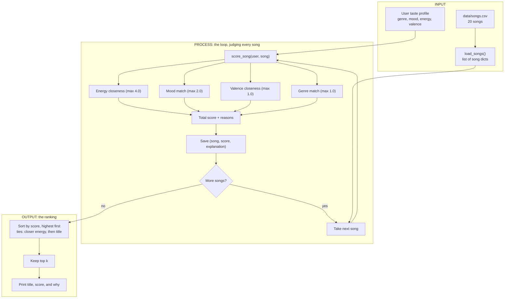

# 🎵 Music Recommender Simulation

## Project Summary

In this project you will build and explain a small music recommender system.

Your goal is to:

- Represent songs and a user "taste profile" as data
- Design a scoring rule that turns that data into recommendations
- Evaluate what your system gets right and wrong
- Reflect on how this mirrors real world AI recommenders

Replace this paragraph with your own summary of what your version does.

---

## How The System Works

Real-world platforms like Spotify and YouTube combine two ideas. **Collaborative filtering** learns from other users' behavior (plays, skips, likes, playlist co-occurrence) to find songs that people with similar taste enjoyed. **Content-based filtering** looks at the songs themselves (genre, tempo, energy, mood) and recommends items similar to what a user already likes. Production systems blend both, then rank a large candidate pool using many signals. This simulation has no listening history, so it is a **content-based recommender**: it compares each song's attributes to a user's stated taste profile. It prioritizes **how close a song's energy is to the user's target** (the strongest and cleanest signal in the catalog), then **mood match** (the closest thing to a "vibe" label), with **genre** as a smaller nudge and **valence** as an optional refinement. Numeric features reward *closeness* to the user's target, not simply higher or lower values.

### Song features

Each `Song` stores: `id`, `title`, `artist`, `genre`, `mood`, `energy`, `tempo_bpm`, `valence`, `danceability`, `acousticness`.

Used in scoring: `energy`, `mood`, `genre`, and `valence`. The rest are kept for display and future experiments. `tempo_bpm`, `danceability`, and `acousticness` are left out of the core score because they correlate strongly with energy in this catalog (r = 0.89, 0.66, and -0.91 across the 20-song catalog), so including them would mostly count the same signal several times.

### UserProfile features

Each `UserProfile` stores: `favorite_genre`, `favorite_mood`, `target_energy`, `likes_acoustic`. A `target_valence` field is planned as an optional addition for the valence term.

### Data flow



In code: `main.py` builds the profile and calls `recommend_songs()`, which runs the loop by calling `score_song()` once per song, then sorts and slices the top `k`. Scoring judges a single song in isolation, and ranking is the only step that sees the whole list.

### Algorithm recipe: scoring and ranking

**Scoring rule (one song):**

```
score = 4.0 * exp(-(song.energy - target_energy)^2 / (2 * 0.25^2))   # energy closeness
      + 2.0 * mood_match                                              # 1.0 exact, 0.5 same mood cluster, else 0
      + 1.0 * (1 - |song.valence - target_valence|)                   # only if the user has a valence target
      + 1.0 * (1 if song.genre == favorite_genre else 0)
```

The maximum score is 8.0.

| Term | Max points | Why |
|---|---|---|
| Energy (Gaussian closeness) | 4.0 | Strongest, cleanest signal. The Gaussian shape forgives small gaps but penalizes large ones, so labels cannot easily outvote a very wrong energy level. |
| Mood | 2.0 | Closest thing to a "vibe" label. Worth more than genre. |
| Valence (linear closeness) | 1.0 | The one numeric axis that is independent of energy. Small weight because it is a refinement. |
| Genre | 1.0 | Genres are sparse (most appear once), so a genre match is a nudge, not a deciding factor. |

**Mood clusters** give partial credit (half the mood weight) when the moods are different but close:

- calm: chill, relaxed, focused, dreamy
- sad: melancholy, wistful, nostalgic, moody
- upbeat: happy, uplifting, playful, euphoric
- intense: intense, angry, confident

**Why not the common 2.0 genre / 1.0 mood starting point?** Tested on this catalog, genre-heavy weights rank the intense gym song (Gym Hero) above the happy indie-pop song (Rooftop Lights) for a pop and happy listener, and exact label matching gives zero credit to near-miss moods. Mood outweighing genre, plus partial mood credit, fixed both.

**Not scored:** `likes_acoustic` is stored on the profile but not used in the score. Acousticness correlates -0.91 with energy, so it would mostly double-count energy.

**Ranking rule (the whole list):** score every song, sort by score descending (ties broken by energy closeness, then title), and return the top `k`. Scoring judges one song in isolation, while ranking turns those scores into an ordered list, so the two are kept separate.

### Biases I expect

- **Energy dominates.** Energy is half of the maximum score (4.0 of 8.0). A song that matches a listener's mood and genre perfectly but sits at the wrong energy level will rarely win, and a listener whose taste spans very different energy levels (calm study music and high-energy workout music) will be pulled toward the middle and served neither.
- **Labels beat measurements.** Mood and genre are exact text matches (with partial credit only inside my hand-made mood clusters), so the system rewards a song for carrying the right tag, not for sounding right. Moods outside the clusters, such as "romantic" or "aggressive", get no partial credit, and "indie pop" gets none for a "pop" listener. The clusters are my own judgment, not data.
- **Valence is easy to outvote.** It is worth only 1.0 point, so a mood label can outweigh it. In testing, an intense pop song (Gym Hero) still reached #2 for a rock listener who wanted low-valence music.
- **The catalog favors some listeners.** There are only 20 songs and most genres and moods appear once. Lofi and chill have three songs each, so a lofi listener gets a full top 5 of good matches, while a metal or classical listener gets exactly one genre match and then filler chosen by energy alone.
- **One taste, no dislikes.** A profile has a single genre, mood, and energy point. It cannot say "never metal", list several favorites, or give a range, and `likes_acoustic` is not scored.
- **No discovery.** A content-based system only returns songs similar to what the user already said they like, so it narrows taste instead of widening it, and with no skip or play data it cannot learn when its guess is wrong.

---

## Getting Started

### Setup

1. Create a virtual environment (optional but recommended):

   ```bash
   python -m venv .venv
   source .venv/bin/activate      # Mac or Linux
   .venv\Scripts\activate         # Windows

2. Install dependencies

```bash
pip install -r requirements.txt
```

3. Run the app:

```bash
python -m src.main
```

### Running Tests

Run the starter tests with:

```bash
pytest
```

You can add more tests in `tests/test_recommender.py`.

---

## Sample Recommendation Output

Paste a sample of your recommender's output here as a text block so a reader can see what it produces:

```
# e.g.:
# User profile: genre=indie, mood=chill, energy=low
# Recommendations:
#   1. ...
#   2. ...
#   3. ...
```

**Screenshot or video** *(optional)*: <!-- Insert a screenshot or demo video link here -->

---

## Experiments You Tried

Use this section to document the experiments you ran. For example:

- What happened when you changed the weight on genre from 2.0 to 0.5
- What happened when you added tempo or valence to the score
- How did your system behave for different types of users

---

## Limitations and Risks

Summarize some limitations of your recommender.

Examples:

- It only works on a tiny catalog
- It does not understand lyrics or language
- It might over favor one genre or mood

You will go deeper on this in your model card.

---

## Reflection

Read and complete `model_card.md`:

[**Model Card**](model_card.md)

Write 1 to 2 paragraphs here about what you learned:

- about how recommenders turn data into predictions
- about where bias or unfairness could show up in systems like this


