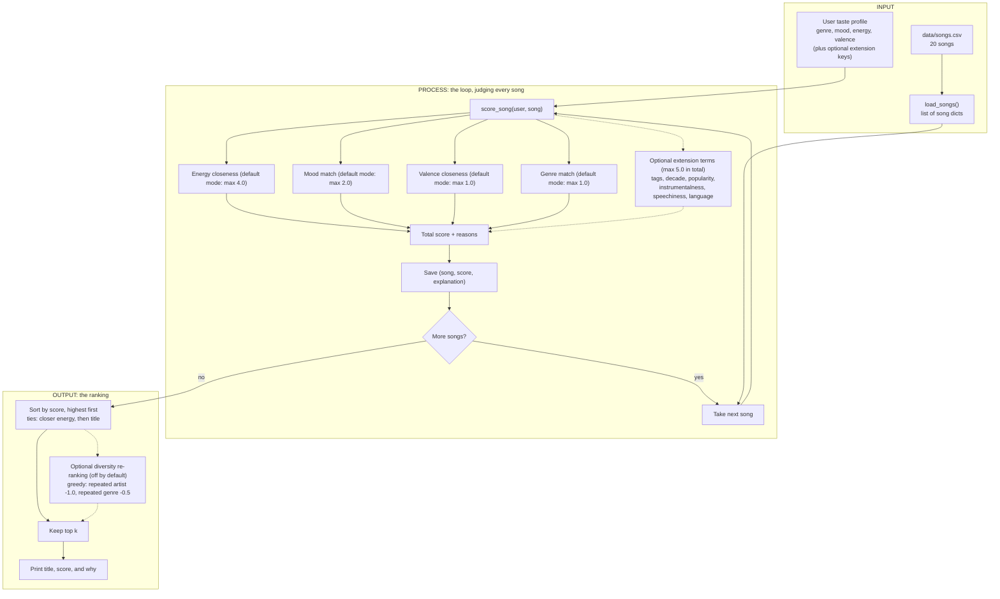

# 🎵 Music Recommender Simulation

## Project Summary

In this project you will build and explain a small music recommender system.

Your goal is to:

- Represent songs and a user "taste profile" as data
- Design a scoring rule that turns that data into recommendations
- Evaluate what your system gets right and wrong
- Reflect on how this mirrors real world AI recommenders

My version is **VibeCheck 1.0**, a small content-based music recommender that runs in the terminal. It reads a 20-song catalog and scores every song against a listener's taste profile (genre, mood, energy, and sunniness). Then it prints the top 5 with the points behind each pick. I tested it with ten profiles, six of them built to trick it, and used the results to document its biases and limits.

---

## How The System Works

Real-world platforms like Spotify and YouTube combine two ideas. **Collaborative filtering** learns from other users' behavior (plays, skips, likes, playlist co-occurrence) to find songs that people with similar taste enjoyed. **Content-based filtering** looks at the songs themselves (genre, tempo, energy, mood) and recommends items similar to what a user already likes. Production systems blend both, then rank a large candidate pool using many signals. This simulation has no listening history, so it is a **content-based recommender**: it compares each song's attributes to a user's stated taste profile. It prioritizes **how close a song's energy is to the user's target** (the strongest and cleanest signal in the catalog), then **mood match** (the closest thing to a "vibe" label), with **genre** as a smaller nudge and **valence** as an optional refinement. Numeric features reward *closeness* to the user's target, not simply higher or lower values.

### Song features

Each `Song` stores: `id`, `title`, `artist`, `genre`, `mood`, `energy`, `tempo_bpm`, `valence`, `danceability`, `acousticness`. It also has six optional extension fields (invented values, all defaulting to empty): `popularity`, `release_decade`, `mood_tags`, `instrumentalness`, `speechiness`, `language` (see "Optional Extensions" at the end).

Used in the base score: `energy`, `mood`, `genre`, and `valence`. The six extension fields are only scored when a profile asks for them. The rest are kept for display and future experiments. `tempo_bpm`, `danceability`, and `acousticness` are left out of the core score because they correlate strongly with energy in this catalog (r = 0.89, 0.66, and -0.91 across the 20-song catalog), so including them would mostly count the same signal several times.

### UserProfile features

Each `UserProfile` stores: `favorite_genre`, `favorite_mood`, `target_energy`, `likes_acoustic`. An optional `target_valence` field (empty by default) adds the valence term to the score. Six more optional fields (`mood_tags`, `decade`, `popularity`, `instrumentalness`, `speechiness`, `language`, all `None` by default) switch on the extension terms.

### Data flow



In code: `main.py` builds the profile and calls `recommend_songs()`, which runs the loop by calling `score_song()` once per song, then sorts and slices the top `k`. (An optional greedy diversity re-ranking can replace the plain sort; see "Challenge 3: Diversity penalty". It is off by default.) Scoring judges a single song in isolation, and ranking is the only step that sees the whole list. The `Recommender` class in `src/recommender.py` wraps the same two functions for the object-style API.

### Algorithm recipe: scoring and ranking

**Scoring rule (one song), default (balanced) mode:**

```
score = 4.0 * exp(-(song.energy - target_energy)^2 / (2 * 0.25^2))   # energy closeness
      + 2.0 * mood_match                                              # 1.0 exact, 0.5 same mood cluster, else 0
      + 1.0 * (1 - |song.valence - target_valence|)                   # only if the user has a valence target
      + 1.0 * (1 if song.genre == favorite_genre else 0)
```

In the default (balanced) mode the maximum base score is 8.0. Targets outside 0 to 1 are clamped to that range first. Other scoring modes change the four weights (see "Challenge 2: Multiple scoring modes"), and everything below describes the default mode.

The default (balanced) base recipe is unchanged. The extension terms (see "Optional Extensions") are opt-in: each one is added only when the profile contains its key, and together they add up to at most +5.0. So in the default mode the maximum is 8.0 for a base profile and up to 13.0 for a profile that uses every extension key.

| Term | Max points (default mode) | Why |
|---|---|---|
| Energy (Gaussian closeness) | 4.0 | Strongest, cleanest signal. The Gaussian shape forgives small gaps but penalizes large ones, so labels usually cannot outvote a very wrong energy level. The exception is an extreme target where no song is close: then the labels can decide the order (see the stress test). |
| Mood | 2.0 | Closest thing to a "vibe" label. Worth more than genre. |
| Valence (linear closeness) | 1.0 | The one numeric axis that is independent of energy. Small weight because it is a refinement. |
| Genre | 1.0 | Genres are sparse (most appear once), so a genre match is a nudge, not a deciding factor. |

**Mood clusters** give partial credit (half the mood weight) when the moods are different but close:

- calm: chill, relaxed, focused, dreamy
- sad: melancholy, wistful, nostalgic, moody
- upbeat: happy, uplifting, playful, euphoric
- intense: intense, angry, confident

**Why not the common 2.0 genre / 1.0 mood starting point?** Tested on this catalog, genre-heavy weights rank the intense gym song (Gym Hero) above the happy indie-pop song (Rooftop Lights) for a pop and happy listener, and exact label matching gives zero credit to near-miss moods. Mood outweighing genre, plus partial mood credit, fixed both.

**Not scored:** `likes_acoustic` is stored on the profile but not used in the score. Acousticness correlates -0.91 with energy, so it would mostly double-count energy.

**Ranking rule (the whole list):** score every song, sort by score descending (ties broken by energy closeness, then title), and return the top `k`. Scoring judges one song in isolation, while ranking turns those scores into an ordered list, so the two are kept separate. This is the default. An optional diversity re-ranking (off unless asked for) builds the top `k` greedily and takes points off a song when the same artist or genre is already in the list; see "Challenge 3: Diversity penalty".

### Biases I expect

- **Energy dominates.** Energy is half of the maximum score in the default mode (4.0 of 8.0). A song that matches a listener's mood and genre perfectly but sits at the wrong energy level will rarely win, and a listener whose taste spans very different energy levels (calm study music and high-energy workout music) will be pulled toward the middle and served neither.
- **Labels beat measurements.** Mood and genre are exact text matches (with partial credit only inside my hand-made mood clusters), so the system rewards a song for carrying the right tag, not for sounding right. Moods outside the clusters, such as "romantic" or "aggressive", get no partial credit, and "indie pop" gets none for a "pop" listener. The clusters are my own judgment, not data.
- **Valence is easy to outvote.** It is worth only 1.0 point, so a mood label can outweigh it. In testing, an intense pop song (Gym Hero) still reached #2 for a rock listener who wanted low-valence music.
- **The catalog favors some listeners.** There are only 20 songs and most genres and moods appear once. Lofi and chill have three songs each, so a lofi listener gets a full top 5 of good matches, while a metal or classical listener gets exactly one genre match and then filler chosen by energy alone.
- **One taste, no dislikes.** A profile has a single genre, mood, and energy point. It cannot say "never metal", list several favorites, or give a range, and `likes_acoustic` is not scored.
- **No discovery.** A content-based system only returns songs similar to what the user already said they like, so it narrows taste instead of widening it, and with no skip or play data it cannot learn when its guess is wrong.

---

## Getting Started

### Setup

1. Create a virtual environment (optional but recommended):

   ```bash
   python -m venv .venv
   source .venv/bin/activate      # Mac or Linux
   .venv\Scripts\activate         # Windows
   ```

2. Install dependencies

```bash
pip install -r requirements.txt
```

3. Run the app (from the project root):

```bash
python -m src.main               # default pop/happy profile
python -m src.main lofi/chill    # any profile name in src/main.py
python -m src.main all           # the four everyday profiles
python -m src.main adversarial   # the six edge-case profiles
python -m src.main extensions    # the four profiles that use the extension attributes
python -m src.main ext-90s-nostalgia   # one extension profile (also ext-hidden-gems, ext-instrumental-focus, ext-chart-hits)
python -m src.main --mode MODE         # rank with another scoring mode (see below)
python -m src.main lofi/chill --mode energy-focused   # a profile plus a mode
python -m src.main all --mode genre-first             # every everyday profile in one mode
python -m src.main --list-modes        # show the four scoring modes and exit
python -m src.main lofi/chill --diverse                  # penalize repeated artists and genres in the top 5
python -m src.main lofi/chill --diverse --mode mood-first   # diversity plus another scoring mode
python -m src.main all --diverse                         # every everyday profile with diversity on
python -m src.main pop/happy --table                     # the top 5 as a table with the reasons (100 columns wide)
python -m src.main lofi/chill --table --diverse          # a table with the diversity penalty lines in it
python -m src.main lofi/chill --table --mode mood-first  # a table in another scoring mode
python -m src.main all --table --width 80                # every everyday profile as an 80-column table
```

`--table` shows each profile's results as a table instead of the list. `--width N` sets the table width in columns (default 100, minimum 60) and is ignored without `--table`.

### Running Tests

Run the tests with:

```bash
pytest
```

There are 735 test cases in two files (`pytest --collect-only -q` counts parametrized cases separately). `tests/test_recommender.py` has 610 cases, written as 95 test functions. They check the `Recommender` class (including a reversed-input test and a match against the function-based version), the input cleaning, the extension attributes (CSV loading, each scoring term with hand-computed values, the `UserProfile` extension fields, and the `extensions` CLI keyword), and the scoring modes (the exact weight table, `ScoringMode` validation, tie-breaking in every mode, and the `--mode` and `--list-modes` flags), and the diversity penalty (the exact score arithmetic, ties, that zero penalties equal the plain result, validation of `k` and of the penalty sizes, missing artists or genres, the `Recommender` pass-through, and the `--diverse` flag). A few extension tests check exact scores; the original tests do not.

`tests/test_table.py` has 125 cases, written as 35 test functions, for the table output. They check, for every profile in every scoring mode with diversity on and off, that every table line has the same width and fits the width asked for, that every title, artist, score and reason is shown in full (one reason per bullet), and that Score and Rank are right-aligned. They also pin the exact column widths for several real profiles, the blank line before the table in the CLI output, the empty and whitespace-only fields, the zero-width characters, the bad widths (`--width 59`, `abc`), and that `--table` and `--width` change the CLI output while the plain output stays the same.

---

## Sample Recommendation Output

Output of `python -m src.main` for the default pop/happy profile:

```
Loaded songs: 20
================================================================
 Top 5 recommendations for profile: pop/happy
 Targets: genre=pop, mood=happy, energy=0.80, valence=0.80
================================================================

1. Sunrise City by Neon Echo
   Score: 7.95   (pop, happy)
   Why:
     - energy 0.82 vs target 0.80 (+3.99)
     - mood match: happy (+2.00)
     - valence 0.84 vs target 0.80 (+0.96)
     - genre match: pop (+1.00)

2. Rooftop Lights by Indigo Parade
   Score: 6.94   (indie pop, happy)
   Why:
     - energy 0.76 vs target 0.80 (+3.95)
     - mood match: happy (+2.00)
     - valence 0.81 vs target 0.80 (+0.99)

3. Sabor de Noche by Marisol Vega
   Score: 5.90   (latin, playful)
   Why:
     - energy 0.80 vs target 0.80 (+4.00)
     - similar mood: playful is close to happy (+1.00)
     - valence 0.90 vs target 0.80 (+0.90)

4. Pulse Garden by Kinetic Bloom
   Score: 5.48   (edm, euphoric)
   Why:
     - energy 0.92 vs target 0.80 (+3.56)
     - similar mood: euphoric is close to happy (+1.00)
     - valence 0.88 vs target 0.80 (+0.92)

5. Gym Hero by Max Pulse
   Score: 5.46   (pop, intense)
   Why:
     - energy 0.93 vs target 0.80 (+3.49)
     - valence 0.77 vs target 0.80 (+0.97)
     - genre match: pop (+1.00)
```

Other profiles are defined in `PROFILES` in `src/main.py` (the extension profiles are in `EXTENSION_PROFILES`, see "Optional Extensions"). For example, `python -m src.main lofi/chill` runs the late-night study listener.

---

## Experiments You Tried

Every result in this section was run in the default (balanced) mode, before the scoring modes existed, and the default output has not changed since.

### Stress test: diverse profiles

Profiles live in `PROFILES` and `ADVERSARIAL_PROFILES` in `src/main.py`. (A fourth dict, `EXTENSION_PROFILES`, holds the four profiles for the optional extra song attributes. They are not part of this ten-profile evaluation.) The adversarial ones came from a separate "System Evaluation" review session that was asked to design profiles that could trick the scoring logic. Every block below is real terminal output (`python -m src.main <profile>`). The pop/happy profile is shown in "Sample Recommendation Output" above.

#### Three distinct everyday profiles

**`lofi/chill`**

```
================================================================
 Top 5 recommendations for profile: lofi/chill
 Targets: genre=lofi, mood=chill, energy=0.40, valence=0.60
================================================================

1. Midnight Coding by LoRoom
   Score: 7.95   (lofi, chill)
   Why:
     - energy 0.42 vs target 0.40 (+3.99)
     - mood match: chill (+2.00)
     - valence 0.56 vs target 0.60 (+0.96)
     - genre match: lofi (+1.00)

2. Library Rain by Paper Lanterns
   Score: 7.92   (lofi, chill)
   Why:
     - energy 0.35 vs target 0.40 (+3.92)
     - mood match: chill (+2.00)
     - valence 0.60 vs target 0.60 (+1.00)
     - genre match: lofi (+1.00)

3. Focus Flow by LoRoom
   Score: 6.99   (lofi, focused)
   Why:
     - energy 0.40 vs target 0.40 (+4.00)
     - similar mood: focused is close to chill (+1.00)
     - valence 0.59 vs target 0.60 (+0.99)
     - genre match: lofi (+1.00)

4. Spacewalk Thoughts by Orbit Bloom
   Score: 6.51   (ambient, chill)
   Why:
     - energy 0.28 vs target 0.40 (+3.56)
     - mood match: chill (+2.00)
     - valence 0.65 vs target 0.60 (+0.95)

5. Coffee Shop Stories by Slow Stereo
   Score: 5.86   (jazz, relaxed)
   Why:
     - energy 0.37 vs target 0.40 (+3.97)
     - similar mood: relaxed is close to chill (+1.00)
     - valence 0.71 vs target 0.60 (+0.89)
```

Works as intended. All five picks are calm songs (energy 0.28 to 0.42). Midnight Coding and Library Rain are a near tie (7.95 vs 7.92), and Focus Flow (lofi, focused) earns half mood credit for being in the calm cluster.

**`high-energy pop`**

```
================================================================
 Top 5 recommendations for profile: high-energy pop
 Targets: genre=pop, mood=euphoric, energy=0.95, valence=0.85
================================================================

1. Pulse Garden by Kinetic Bloom
   Score: 6.94   (edm, euphoric)
   Why:
     - energy 0.92 vs target 0.95 (+3.97)
     - mood match: euphoric (+2.00)
     - valence 0.88 vs target 0.85 (+0.97)

2. Sunrise City by Neon Echo
   Score: 6.48   (pop, happy)
   Why:
     - energy 0.82 vs target 0.95 (+3.49)
     - similar mood: happy is close to euphoric (+1.00)
     - valence 0.84 vs target 0.85 (+0.99)
     - genre match: pop (+1.00)

3. Gym Hero by Max Pulse
   Score: 5.91   (pop, intense)
   Why:
     - energy 0.93 vs target 0.95 (+3.99)
     - valence 0.77 vs target 0.85 (+0.92)
     - genre match: pop (+1.00)

4. Sabor de Noche by Marisol Vega
   Score: 5.29   (latin, playful)
   Why:
     - energy 0.80 vs target 0.95 (+3.34)
     - similar mood: playful is close to euphoric (+1.00)
     - valence 0.90 vs target 0.85 (+0.95)

5. Rooftop Lights by Indigo Parade
   Score: 4.96   (indie pop, happy)
   Why:
     - energy 0.76 vs target 0.95 (+3.00)
     - similar mood: happy is close to euphoric (+1.00)
     - valence 0.81 vs target 0.85 (+0.96)
```

Pulse Garden (edm, euphoric) beats both pop songs: an exact mood match and energy 0.92 outweigh the genre bonus. The catalog has only two pop songs, so Gym Hero (pop, intense, no mood credit) lands at #3. Reasonable for a workout listener.

**`deep intense rock`**

```
================================================================
 Top 5 recommendations for profile: deep intense rock
 Targets: genre=rock, mood=intense, energy=0.95, valence=0.25
================================================================

1. Storm Runner by Voltline
   Score: 7.72   (rock, intense)
   Why:
     - energy 0.91 vs target 0.95 (+3.95)
     - mood match: intense (+2.00)
     - valence 0.48 vs target 0.25 (+0.77)
     - genre match: rock (+1.00)

2. Gym Hero by Max Pulse
   Score: 6.47   (pop, intense)
   Why:
     - energy 0.93 vs target 0.95 (+3.99)
     - mood match: intense (+2.00)
     - valence 0.77 vs target 0.25 (+0.48)

3. Iron Tide by Black Harbor
   Score: 5.94   (metal, angry)
   Why:
     - energy 0.97 vs target 0.95 (+3.99)
     - similar mood: angry is close to intense (+1.00)
     - valence 0.20 vs target 0.25 (+0.95)

4. Concrete Crown by Kid Atlas
   Score: 4.84   (hip hop, confident)
   Why:
     - energy 0.78 vs target 0.95 (+3.17)
     - similar mood: confident is close to intense (+1.00)
     - valence 0.58 vs target 0.25 (+0.67)

5. Pulse Garden by Kinetic Bloom
   Score: 4.34   (edm, euphoric)
   Why:
     - energy 0.92 vs target 0.95 (+3.97)
     - valence 0.88 vs target 0.25 (+0.37)
```

Storm Runner is a near-perfect match. The surprise is #2: Gym Hero (pop, valence 0.77) outranks Iron Tide (metal, valence 0.20) even though the profile wants dark music (valence 0.25). Gym Hero is tagged exactly "intense" (+2.00) while Iron Tide is tagged "angry" (+1.00), and that one point outweighs Iron Tide's much better valence fit (+0.95 vs +0.48).

#### Adversarial and edge-case profiles

**`adv-conflict-sad`**: Conflict: sad and dark, but at high energy.

```
================================================================
 Top 5 recommendations for profile: adv-conflict-sad
 Targets: genre=classical, mood=melancholy, energy=0.95, valence=0.20
================================================================

1. Iron Tide by Black Harbor
   Score: 4.99   (metal, angry)
   Why:
     - energy 0.97 vs target 0.95 (+3.99)
     - valence 0.20 vs target 0.20 (+1.00)

2. Storm Runner by Voltline
   Score: 4.67   (rock, intense)
   Why:
     - energy 0.91 vs target 0.95 (+3.95)
     - valence 0.48 vs target 0.20 (+0.72)

3. Night Drive Loop by Neon Echo
   Score: 4.61   (synthwave, moody)
   Why:
     - energy 0.75 vs target 0.95 (+2.90)
     - similar mood: moody is close to melancholy (+1.00)
     - valence 0.49 vs target 0.20 (+0.71)

4. Gym Hero by Max Pulse
   Score: 4.42   (pop, intense)
   Why:
     - energy 0.93 vs target 0.95 (+3.99)
     - valence 0.77 vs target 0.20 (+0.43)

5. Pulse Garden by Kinetic Bloom
   Score: 4.29   (edm, euphoric)
   Why:
     - energy 0.92 vs target 0.95 (+3.97)
     - valence 0.88 vs target 0.20 (+0.32)
```

Energy wins outright. The classical, melancholy song Moonlit Sonata (energy 0.22) matches both labels but is not in the top 5. A listener who asks for "sad" gets metal, rock and EDM; only Night Drive Loop (moody) is even close.

**`adv-ghost-labels`**: Genre and mood that do not exist in the catalog.

```
================================================================
 Top 5 recommendations for profile: adv-ghost-labels
 Targets: genre=k-pop, mood=aggressive, energy=0.70, valence=0.70
================================================================

1. Rooftop Lights by Indigo Parade
   Score: 4.78   (indie pop, happy)
   Why:
     - energy 0.76 vs target 0.70 (+3.89)
     - valence 0.81 vs target 0.70 (+0.89)

2. Night Drive Loop by Neon Echo
   Score: 4.71   (synthwave, moody)
   Why:
     - energy 0.75 vs target 0.70 (+3.92)
     - valence 0.49 vs target 0.70 (+0.79)

3. Concrete Crown by Kid Atlas
   Score: 4.68   (hip hop, confident)
   Why:
     - energy 0.78 vs target 0.70 (+3.80)
     - valence 0.58 vs target 0.70 (+0.88)

4. Sabor de Noche by Marisol Vega
   Score: 4.49   (latin, playful)
   Why:
     - energy 0.80 vs target 0.70 (+3.69)
     - valence 0.90 vs target 0.70 (+0.80)

5. Sunrise City by Neon Echo
   Score: 4.42   (pop, happy)
   Why:
     - energy 0.82 vs target 0.70 (+3.56)
     - valence 0.84 vs target 0.70 (+0.86)
```

No crash, but nothing can match a label, so the ranking comes from energy and valence alone. The scores are bunched (4.78 down to 4.42) and the order is close to arbitrary, yet the output looks as confident as any other.

**`adv-extreme-zero`**: Extreme numeric targets (energy 0.0, valence 0.0) with labels that point at loud, bright songs.

```
================================================================
 Top 5 recommendations for profile: adv-extreme-zero
 Targets: genre=pop, mood=happy, energy=0.00, valence=0.00
================================================================

1. Moonlit Sonata by Elara Voss
   Score: 3.48   (classical, melancholy)
   Why:
     - energy 0.22 vs target 0.00 (+2.72)
     - valence 0.24 vs target 0.00 (+0.76)

2. Sunrise City by Neon Echo
   Score: 3.18   (pop, happy)
   Why:
     - energy 0.82 vs target 0.00 (+0.02)
     - mood match: happy (+2.00)
     - valence 0.84 vs target 0.00 (+0.16)
     - genre match: pop (+1.00)

3. Spacewalk Thoughts by Orbit Bloom
   Score: 2.49   (ambient, chill)
   Why:
     - energy 0.28 vs target 0.00 (+2.14)
     - valence 0.65 vs target 0.00 (+0.35)

4. Paper Boats by Willow & Ash
   Score: 2.29   (folk, wistful)
   Why:
     - energy 0.33 vs target 0.00 (+1.67)
     - valence 0.38 vs target 0.00 (+0.62)

5. Rooftop Lights by Indigo Parade
   Score: 2.23   (indie pop, happy)
   Why:
     - energy 0.76 vs target 0.00 (+0.04)
     - mood match: happy (+2.00)
     - valence 0.81 vs target 0.00 (+0.19)
```

Moonlit Sonata is the right #1, but Sunrise City (energy 0.82, valence 0.84) takes #2 over calmer, darker songs. Its genre and mood match add 3.00 points and its energy term is almost zero, but every other song is also far from the target. This contradicts the recipe note that labels "cannot easily outvote" a wrong energy level.

**`adv-calm-labels-high-energy`**: Calm labels (ambient, chill) with a very high energy target.

```
================================================================
 Top 5 recommendations for profile: adv-calm-labels-high-energy
 Targets: genre=ambient, mood=chill, energy=0.92, valence=0.85
================================================================

1. Pulse Garden by Kinetic Bloom
   Score: 4.97   (edm, euphoric)
   Why:
     - energy 0.92 vs target 0.92 (+4.00)
     - valence 0.88 vs target 0.85 (+0.97)

2. Gym Hero by Max Pulse
   Score: 4.92   (pop, intense)
   Why:
     - energy 0.93 vs target 0.92 (+4.00)
     - valence 0.77 vs target 0.85 (+0.92)

3. Sunrise City by Neon Echo
   Score: 4.68   (pop, happy)
   Why:
     - energy 0.82 vs target 0.92 (+3.69)
     - valence 0.84 vs target 0.85 (+0.99)

4. Storm Runner by Voltline
   Score: 4.63   (rock, intense)
   Why:
     - energy 0.91 vs target 0.92 (+4.00)
     - valence 0.48 vs target 0.85 (+0.63)

5. Sabor de Noche by Marisol Vega
   Score: 4.51   (latin, playful)
   Why:
     - energy 0.80 vs target 0.92 (+3.56)
     - valence 0.90 vs target 0.85 (+0.95)
```

The numbers win and no ambient or chill song appears. That is defensible, but the genre and mood request is effectively ignored. Pulse Garden and Gym Hero are only 0.05 apart.

**`adv-energy-only`**: A thin profile with only an energy target.

```
================================================================
 Top 5 recommendations for profile: adv-energy-only
 Targets: energy=0.50
================================================================

1. Hazy Static by Glass Orchard
   Score: 3.99   (shoegaze, dreamy)
   Why:
     - energy 0.52 vs target 0.50 (+3.99)

2. Velvet Hours by Luna Marsh
   Score: 3.99   (r&b, romantic)
   Why:
     - energy 0.48 vs target 0.50 (+3.99)

3. Dust Road Home by Hollow Pines
   Score: 3.92   (country, nostalgic)
   Why:
     - energy 0.55 vs target 0.50 (+3.92)

4. Island Breeze by Sol Rivera
   Score: 3.80   (reggae, uplifting)
   Why:
     - energy 0.58 vs target 0.50 (+3.80)

5. Midnight Coding by LoRoom
   Score: 3.80   (lofi, chill)
   Why:
     - energy 0.42 vs target 0.50 (+3.80)
```

Graceful, with no crash. The top two songs tie at 3.99 with the same energy gap, so the title tie-break decides. Scores can never exceed 4.0, but nothing in the output signals that the profile was thin.

**`adv-romantic-rnb`**: A mood (romantic) that is in no mood cluster, with a perfect catalog match.

```
================================================================
 Top 5 recommendations for profile: adv-romantic-rnb
 Targets: genre=r&b, mood=romantic, energy=0.48, valence=0.62
================================================================

1. Velvet Hours by Luna Marsh
   Score: 8.00   (r&b, romantic)
   Why:
     - energy 0.48 vs target 0.48 (+4.00)
     - mood match: romantic (+2.00)
     - valence 0.62 vs target 0.62 (+1.00)
     - genre match: r&b (+1.00)

2. Midnight Coding by LoRoom
   Score: 4.83   (lofi, chill)
   Why:
     - energy 0.42 vs target 0.48 (+3.89)
     - valence 0.56 vs target 0.62 (+0.94)

3. Dust Road Home by Hollow Pines
   Score: 4.81   (country, nostalgic)
   Why:
     - energy 0.55 vs target 0.48 (+3.85)
     - valence 0.66 vs target 0.62 (+0.96)

4. Hazy Static by Glass Orchard
   Score: 4.78   (shoegaze, dreamy)
   Why:
     - energy 0.52 vs target 0.48 (+3.95)
     - valence 0.45 vs target 0.62 (+0.83)

5. Focus Flow by LoRoom
   Score: 4.77   (lofi, focused)
   Why:
     - energy 0.40 vs target 0.48 (+3.80)
     - valence 0.59 vs target 0.62 (+0.97)
```

Velvet Hours scores a perfect 8.00, then there is a 3.17-point cliff. Ranks 2 to 5 sit within 0.06 of each other and are effectively a coin flip, because nothing else earns any mood credit.

#### What the stress test showed

1. **Energy beats labels when songs exist near the target, and labels win when none do.** The sad and calm profiles lose their mood and genre to the energy term, because plenty of songs sit near the high-energy target. At an extreme target like energy 0.0, almost every song gets near-zero energy points, so a genre and mood match (+3.00) decides the order. The recipe's claim that labels cannot easily outvote a very wrong energy level holds only in the first case.
2. **Exact label tags can outweigh a better sonic fit.** Gym Hero over Iron Tide for the rock listener is the clearest example: a song is rewarded for carrying the right word, and "angry" vs "intense" is a one-point difference.
3. **Weak results look as confident as strong ones.** With ghost labels, an energy-only profile, or an empty profile, the system still prints five songs with no warning that nothing matched. Scores are also not bounded to 0 to 8 for out-of-range input.

I also probed inputs directly (not in `main.py`): an empty profile `{}` scores every song 0.00 and returns them alphabetically; `energy` 1.5 with `valence` -1.0 gives negative scores; `energy` given as the string `"0.8"` crashes with a `TypeError`; and `"Pop"` or `"Happy "` (different case or a trailing space) silently match nothing. These input problems were fixed afterwards: the recommender now clamps numbers to 0 to 1, ignores case and extra spaces, accepts numbers given as text, and raises a clear `ValueError` for a non-numeric target or an empty profile. The rankings for every valid profile above are unchanged.

### Accuracy and surprises

**Do the results feel right?**

- **pop/happy:** mostly yes. Sunrise City is the only pop and happy song, so it should be #1, and the happy indie-pop song (Rooftop Lights) is a sensible #2. Gym Hero at #5 feels slightly off, because it is an intense workout track, not a happy one. It is there for its genre match and high energy.
- **lofi/chill:** yes. All five picks are calm, low-energy songs.
- **deep intense rock:** mostly, but Gym Hero (upbeat pop) at #2 above Iron Tide (dark metal) feels wrong for a listener who asked for dark music.
- **high-energy pop:** a surprise. The #1 song is an EDM track, not a pop song.

**Why does Pulse Garden rank first for "high-energy pop"?** I asked a separate evaluation session to explain it from the code in `src/recommender.py` and to check the arithmetic by running `score_song`. The profile is `genre=pop, mood=euphoric, energy=0.95, valence=0.85`.

| Song | Energy (max 4.0) | Mood (max 2.0) | Valence (max 1.0) | Genre (max 1.0) | Total |
|---|---|---|---|---|---|
| **Pulse Garden** (edm, euphoric) | 3.97 | 2.00 (exact) | 0.97 | 0 | **6.94** |
| Sunrise City (pop, happy) | 3.49 | 1.00 (same cluster) | 0.99 | 1.00 | 6.48 |
| Gym Hero (pop, intense) | 3.99 | 0 | 0.92 | 1.00 | 5.91 |

Pulse Garden is the only song that gets the full mood match *and* near-perfect energy, and together those are worth more than the 1.00 genre bonus the pop songs get. Over Sunrise City the gap is mood +1.00 and energy +0.48, minus genre 1.00. The ranking is defensible, because my profile asked for "euphoric" and Pulse Garden is the only euphoric song. The surprise comes from the profile pairing a pop genre with a mood only EDM carries, and from genre being the lowest-weighted term.

**How much genre weight would put a pop song first?** About 1.46 for Sunrise City, and it would win by only 0.003, so that is a knife-edge threshold and not a robust fix. Gym Hero would need above 2.03. At 1.46, 2.0 and 3.0 the #1 song for pop/happy, lofi/chill and deep intense rock does not change, so a larger genre weight would not break the other profiles in this catalog. I kept 1.0 because genres are sparse here, and I did not test other energy or mood weights.

**Does the same song keep appearing at the top of every list?** No. Across all 10 profiles there are nine different #1 songs, and only Pulse Garden is #1 twice. Three songs do recur in the top 5: Sunrise City, Pulse Garden and Gym Hero each appear in 5 of the 10 lists (Rooftop Lights and Sabor de Noche in 4). That recurrence does not look like an over-strong genre weight, since genre is only 1 of 8 points. The more likely causes are that six of the ten profiles target energy 0.7 or higher, which favors the same loud, bright songs, and that the 20-song catalog has so few genre and mood matches that energy and valence decide most lists. All 20 songs appear in at least one top 5. The energy term (4.0 of 8.0) is the dominant weight and the first thing to test next.

### Experiment: weight shift (double energy, halve genre)

**Change tested:** `ENERGY_WEIGHT` 4.0 to 8.0 and `GENRE_WEIGHT` 1.0 to 0.5, with everything else unchanged. A separate session applied the edit to `src/recommender.py` and checked that the math stayed valid by running it: the maximum score becomes 11.5 (a perfect-match song, Velvet Hours, scores exactly 11.50), scores never went negative for in-range profiles (minimum 0.13), a perfect energy match earns exactly 8.0, the energy term falls steadily as the gap grows, and the starter tests still pass. I ran every profile before and after, then reverted the change. The original weights are the ones documented above.

Output of `python -m src.main pop/happy` with the experimental weights:

```
================================================================
 Top 5 recommendations for profile: pop/happy
 Targets: genre=pop, mood=happy, energy=0.80, valence=0.80
================================================================

1. Sunrise City by Neon Echo
   Score: 11.43   (pop, happy)
   Why:
     - energy 0.82 vs target 0.80 (+7.97)
     - mood match: happy (+2.00)
     - valence 0.84 vs target 0.80 (+0.96)
     - genre match: pop (+0.50)

2. Rooftop Lights by Indigo Parade
   Score: 10.89   (indie pop, happy)
   Why:
     - energy 0.76 vs target 0.80 (+7.90)
     - mood match: happy (+2.00)
     - valence 0.81 vs target 0.80 (+0.99)

3. Sabor de Noche by Marisol Vega
   Score: 9.90   (latin, playful)
   Why:
     - energy 0.80 vs target 0.80 (+8.00)
     - similar mood: playful is close to happy (+1.00)
     - valence 0.90 vs target 0.80 (+0.90)

4. Pulse Garden by Kinetic Bloom
   Score: 9.05   (edm, euphoric)
   Why:
     - energy 0.92 vs target 0.80 (+7.13)
     - similar mood: euphoric is close to happy (+1.00)
     - valence 0.88 vs target 0.80 (+0.92)

5. Concrete Crown by Kid Atlas
   Score: 8.75   (hip hop, confident)
   Why:
     - energy 0.78 vs target 0.80 (+7.97)
     - valence 0.58 vs target 0.80 (+0.78)
```

**What changed across all 10 profiles:** the #1 song stayed the same in all 10. The full top 5 was identical in 3 profiles, the same five songs in a different order in 3, and a different set of songs in 4.

| Profile | Change in ranks 2 to 5 | Better, worse, or just different? |
|---|---|---|
| pop/happy | Gym Hero (pop, intense) drops out, Concrete Crown (hip hop, confident) enters at #5 | Different. Neither is "happy"; Gym Hero simply lost its genre bonus |
| lofi/chill | none | Unchanged |
| high-energy pop | Rooftop Lights drops out, Storm Runner (rock, intense) enters at #5 | Slightly worse: a rock song now appears for a pop listener |
| deep intense rock | #4 and #5 swap | Different. Gym Hero still outranks Iron Tide |
| adv-conflict-sad | Night Drive Loop (moody, the closest thing to "sad") falls from #3 to #5 | Worse: the one mood-relevant song loses ground |
| adv-ghost-labels | none | Unchanged |
| adv-extreme-zero | Sunrise City and Rooftop Lights drop out; four calm songs fill ranks 2 to 5 | **Better.** The label match no longer beats a very wrong energy |
| adv-calm-labels-high-energy | Sabor de Noche drops out, Iron Tide enters at #5 | Different. The labels were already ignored |
| adv-energy-only | none | Unchanged |
| adv-romantic-rnb | Same songs, reordered (ranks 2 to 5 still within 0.16) | Different. Still a near coin flip |

**Verdict: more different than more accurate.** The change fixed the one case it was aimed at, the extreme-energy profile, where label matches had been outranking songs that fit the energy target. But it made two listeners slightly worse off (the sad listener and the pop listener), and it left the near-ties and the Gym Hero versus Iron Tide problem alone. The top pick is robust to this change, while ranks 3 to 5 are sensitive to the weights. That fits the earlier finding that energy already dominates: doubling it makes the mood and genre labels matter even less, which helps users with extreme energy targets and hurts users who care about mood. I kept the original weights. Absolute scores are not comparable between the two settings, since the maximum moved from 8.0 to 11.5.

Since then, scoring modes make this kind of weight experiment a command-line switch (`--mode`), without editing the code. See "Challenge 2: Multiple scoring modes".

---

## Limitations and Risks

- **Tiny catalog.** There are 20 songs and most genres appear once. The numbers are invented, not measurements: I wrote the energy, valence, and other base values for 10 of the songs, and the extension values (popularity, decade, mood tags, instrumentalness, speechiness, language) are invented for all 20.
- **Energy dominates.** In the default mode it is half of the points. Listeners who want very quiet music (below 0.30 energy) are served worst, because the catalog has almost no songs there.
- **Labels must match word for word.** "Indie pop" earns nothing for a "pop" listener, and "romantic" is in no group of related moods.
- **One taste per profile.** A profile cannot hold several favorites or dislikes. `likes_acoustic` is stored but not scored.
- **Weak matches look confident.** The system always prints five songs, even when nothing matched, and it gives no warning. (Bad input is handled: numbers are clamped to their range, capital letters and extra spaces are ignored, and a non-numeric target or an empty profile raises a clear error. Values inside `songs.csv` are not checked, so a typo such as text in the `popularity` column crashes the scorer, and a NaN or out-of-range number gives odd output.)
- **No lyrics.** The base score ignores language and era, and the optional extension terms only use my invented `language` and `release_decade` values, never real lyrics. The system also learns nothing from skips or likes, so it can only narrow taste, never widen it.

The model card covers these in more detail (sections 5 and 6).

---

## Reflection

The full model card is here: [**Model Card**](model_card.md). My personal reflection is in section 9.

**How recommenders turn data into predictions.** A recommender compares numbers and labels. In my version, each song earns points for how close its energy and sunniness are to the listener's targets, plus points for matching mood and genre. Then a sort picks the top five. Even this tiny version felt like a real recommendation, partly because it explains every pick. It never understands the music, though. It only sees the numbers and tags it was given.

**Where bias or unfairness can show up.** Bias hides in small choices. I gave energy half of all the points, so listeners who want very quiet music were served worst. Labels must match word for word, so an "indie pop" song earns nothing for a "pop" listener. The catalog has one song for most genres, so some listeners get a full list of good matches and others get filler. A real app with millions of songs hides the same problems behind a confident-looking list. It is worth asking who the catalog and the weights were built for.

---

## Optional Extensions

### Challenge 1: Advanced song features

**What I added.** Six new columns in `data/songs.csv`. All values are invented (written by the AI assistant and checked by me), not measured from real music:

- `popularity`: a 0 to 100 "how well known" number.
- `release_decade`: the decade the song came out, such as 1990.
- `mood_tags`: two or three detailed vibe words, separated by `|` (for example `nostalgic|warm|sentimental`).
- `instrumentalness`: 0 to 1, how much of the song has no vocals.
- `speechiness`: 0 to 1, how much of the song is spoken words.
- `language`: the sung language (`en`, `es`, or the pseudo-value `instrumental`).

**How to use them.** Add any of these keys to a profile. A profile that leaves them out scores exactly as before (I checked this against saved output of the original ten profiles).

```python
{
    "genre": "country", "mood": "nostalgic", "energy": 0.55, "valence": 0.65,
    "mood_tags": ["nostalgic", "warm"],   # or "nostalgic|warm"
    "decade": "1990s",                    # 1990, "1990s", or a year like 1994
    "popularity": 40,                     # 0 to 100
    "instrumentalness": 0.0, "speechiness": 0.05, "language": "en",
}
```

Run the four ready-made profiles with `python -m src.main extensions`, or one by name: `ext-90s-nostalgia`, `ext-hidden-gems`, `ext-instrumental-focus`, `ext-chart-hits`. The object-style `UserProfile` has the same six optional fields.

**Scoring terms.** Each term is added only when the profile has its key and the song has the value:

| Key | Max points | Rule |
|---|---|---|
| `mood_tags` | 1.5 | 1.5 times the share of requested tags the song has |
| `decade` | 1.0 | closeness, falling to 0 at 50 years apart |
| `popularity` | 1.0 | `1 - gap / 100` |
| `instrumentalness` | 0.5 | `1 - gap` |
| `speechiness` | 0.5 | `1 - gap` |
| `language` | 0.5 | exact match |

The terms add up to at most 5.0, on top of the base 8.0.

**Real output** of `python -m src.main ext-90s-nostalgia`:

```
Loaded songs: 20
================================================================
 Top 5 recommendations for profile: ext-90s-nostalgia
 Targets: genre=country, mood=nostalgic, energy=0.55, valence=0.65, mood_tags=nostalgic|warm|sentimental, decade=1990
================================================================

1. Dust Road Home by Hollow Pines
   Score: 10.49   (country, nostalgic)
   Why:
     - energy 0.55 vs target 0.55 (+4.00)
     - mood match: nostalgic (+2.00)
     - valence 0.66 vs target 0.65 (+0.99)
     - genre match: country (+1.00)
     - mood tags matched 3 of 3 requested: nostalgic, warm, sentimental (+1.50)
     - decade 1990s vs target 1990s (+1.00)

2. Velvet Hours by Luna Marsh
   Score: 6.32   (r&b, romantic)
   Why:
     - energy 0.48 vs target 0.55 (+3.85)
     - valence 0.62 vs target 0.65 (+0.97)
     - mood tags matched 1 of 3 requested: warm (+0.50)
     - decade 1990s vs target 1990s (+1.00)

3. Hazy Static by Glass Orchard
   Score: 6.27   (shoegaze, dreamy)
   Why:
     - energy 0.52 vs target 0.55 (+3.97)
     - valence 0.45 vs target 0.65 (+0.80)
     - mood tags matched 1 of 3 requested: nostalgic (+0.50)
     - decade 1990s vs target 1990s (+1.00)

4. Island Breeze by Sol Rivera
   Score: 6.06   (reggae, uplifting)
   Why:
     - energy 0.58 vs target 0.55 (+3.97)
     - valence 0.86 vs target 0.65 (+0.79)
     - mood tags matched 1 of 3 requested: warm (+0.50)
     - decade 1980s vs target 1990s (+0.80)

5. Paper Boats by Willow & Ash
   Score: 6.05   (folk, wistful)
   Why:
     - energy 0.33 vs target 0.55 (+2.72)
     - similar mood: wistful is close to nostalgic (+1.00)
     - valence 0.38 vs target 0.65 (+0.73)
     - mood tags matched 2 of 3 requested: warm, sentimental (+1.00)
     - decade 1970s vs target 1990s (+0.60)
```

The 1990s songs move up the list because of the decade and tag terms, even when their energy is a little off.

### Challenge 2: Multiple scoring modes

**What I added.** Four named scoring modes. A mode is a set of weights for the four base terms (energy, mood, valence, genre). The default is `balanced`, which is the recipe described above, so nothing changes unless you ask for another mode. Each mode's weights add up to 8.0, so base scores stay on the same scale. The other settings are shared by all modes: the energy curve width (0.25) and the half credit for a close mood.

| Mode | Energy | Mood | Valence | Genre | Base max | Idea |
|---|---|---|---|---|---|---|
| `balanced` (default) | 4.0 | 2.0 | 1.0 | 1.0 | 8.0 | Standard recipe |
| `genre-first` | 2.0 | 1.5 | 0.5 | 4.0 | 8.0 | The genre label dominates |
| `mood-first` | 2.0 | 4.0 | 1.0 | 1.0 | 8.0 | The mood label dominates |
| `energy-focused` | 5.5 | 1.0 | 1.0 | 0.5 | 8.0 | Energy is almost the whole score |

"Base max" is the highest score for a profile without extension keys. The extension terms from Challenge 1 keep their own weights in every mode, so they are extra on top.

**How to switch.**

- Command line: `python -m src.main pop/happy --mode mood-first`. Show the modes with `python -m src.main --list-modes`. Without `--mode`, the output is exactly the same as before. With another mode, the header gets one extra line, ` Mode: <name>`.
- Python: `recommend_songs(profile, songs, k=5, mode="genre-first")` and `score_song(profile, song, mode="genre-first")`. The object-style API takes it in the constructor: `Recommender(songs, mode="mood-first")`. `mode` can be a name, a `ScoringMode` object, or left out for the default. An unknown name raises a `ValueError` that lists the valid modes.

**The design pattern.** This is a data-driven Strategy pattern. A mode is a frozen dataclass of weights (`ScoringMode`), and the modes live in a registry dict (`MODES`). The scoring code (`score_song`) is shared, and it reads the weights from whichever mode it is given. So adding a mode is one new line in `MODES`, with no change to the scoring code. The honest limit: a mode changes the weights, not the shape of a term. A mode cannot turn the energy curve into a straight line, for example, without a code change.

**Top 3 under each mode** (real runs of `recommend_songs`, score in brackets). The modes disagree most when the profile's labels and numbers pull in different directions.

`adv-conflict-sad` (classical, melancholy, energy 0.95, valence 0.20):

| Mode | #1 | #2 | #3 |
|---|---|---|---|
| balanced | Iron Tide (4.99) | Storm Runner (4.67) | Night Drive Loop (4.61) |
| genre-first | Moonlit Sonata (6.01) | Night Drive Loop (2.56) | Iron Tide (2.49) |
| mood-first | Moonlit Sonata (5.99) | Night Drive Loop (4.16) | Dust Road Home (3.10) |
| energy-focused | Iron Tide (6.48) | Storm Runner (6.15) | Gym Hero (5.91) |

`high-energy pop` (pop, euphoric, energy 0.95, valence 0.85):

| Mode | #1 | #2 | #3 |
|---|---|---|---|
| balanced | Pulse Garden (6.94) | Sunrise City (6.48) | Gym Hero (5.91) |
| genre-first | Sunrise City (6.99) | Gym Hero (6.45) | Pulse Garden (3.97) |
| mood-first | Pulse Garden (6.96) | Sunrise City (5.74) | Sabor de Noche (4.62) |
| energy-focused | Pulse Garden (7.43) | Gym Hero (6.90) | Sunrise City (6.79) |

For the sad-but-loud listener, the label-heavy modes pick the quiet classical piece (Moonlit Sonata), and the energy mode picks a loud metal song (Iron Tide). Scores are only comparable inside one mode.

**Real output** of `python -m src.main --list-modes`:

```
balanced (default): Standard recipe: energy first, then mood, valence and genre.
    energy 4, mood 2, valence 1, genre 1 (base max 8)
genre-first: The genre label dominates, with energy and mood in supporting roles.
    energy 2, mood 1.5, valence 0.5, genre 4 (base max 8)
mood-first: The mood label dominates, with energy as the second voice.
    energy 2, mood 4, valence 1, genre 1 (base max 8)
energy-focused: Energy closeness is almost the whole score.
    energy 5.5, mood 1, valence 1, genre 0.5 (base max 8)
```

**Real output** of `python -m src.main pop/happy --mode mood-first`:

```
Loaded songs: 20
================================================================
 Top 5 recommendations for profile: pop/happy
 Mode: mood-first
 Targets: genre=pop, mood=happy, energy=0.80, valence=0.80
================================================================

1. Sunrise City by Neon Echo
   Score: 7.95   (pop, happy)
   Why:
     - energy 0.82 vs target 0.80 (+1.99)
     - mood match: happy (+4.00)
     - valence 0.84 vs target 0.80 (+0.96)
     - genre match: pop (+1.00)

2. Rooftop Lights by Indigo Parade
   Score: 6.96   (indie pop, happy)
   Why:
     - energy 0.76 vs target 0.80 (+1.97)
     - mood match: happy (+4.00)
     - valence 0.81 vs target 0.80 (+0.99)

3. Sabor de Noche by Marisol Vega
   Score: 4.90   (latin, playful)
   Why:
     - energy 0.80 vs target 0.80 (+2.00)
     - similar mood: playful is close to happy (+2.00)
     - valence 0.90 vs target 0.80 (+0.90)

4. Pulse Garden by Kinetic Bloom
   Score: 4.70   (edm, euphoric)
   Why:
     - energy 0.92 vs target 0.80 (+1.78)
     - similar mood: euphoric is close to happy (+2.00)
     - valence 0.88 vs target 0.80 (+0.92)

5. Island Breeze by Sol Rivera
   Score: 4.30   (reggae, uplifting)
   Why:
     - energy 0.58 vs target 0.80 (+1.36)
     - similar mood: uplifting is close to happy (+2.00)
     - valence 0.86 vs target 0.80 (+0.94)
```

**A change in the command line.** The command line now uses `argparse`. Normal use works as before. But an unknown flag (such as `--bogus`) or an extra word now exits with code 2 and a usage message. Before, the old code printed an "Unknown profile" message and exited with code 1. This matters for profile names with spaces: write `"high-energy pop"` in quotes. An unquoted `high-energy pop` is now two words, and it is rejected by `argparse`. An unknown profile name on its own still prints the same "Unknown profile" message and exits with code 1.

### Challenge 3: Diversity penalty

**What I added.** An optional re-ranking step that stops the top 5 from filling up with the same artist or the same genre. It is off by default, so the normal output is exactly as before.

**The rule, in plain language.** Build the list one song at a time (greedy). For each next pick, take every song not yet picked and subtract points from its normal score: 1.0 for each earlier pick by the same artist, and 0.5 for each earlier pick in the same genre. Pick the song with the highest adjusted score. Repeat until the list has `k` songs. The score printed next to a song is the adjusted one, and every repeat adds one line to "Why", such as `diversity penalty: genre lofi already recommended (-0.50)`. The first pick is never penalized. Ties still go to the closer energy, then the title.

**The rule I gave the AI** (shortened):

> Add an optional diversity penalty. Build the top k greedily. For each next pick, its adjusted score is its normal score minus 1.0 per earlier pick by the same artist, minus 0.5 per earlier pick in the same genre. Report the adjusted score, and add one reason line per penalty. With the penalty off, the output must be byte-for-byte identical to today's.

**Penalty sizes and how to change them.** The defaults are `ARTIST_PENALTY = 1.0` and `GENRE_PENALTY = 0.5` in `src/recommender.py`. Both are 0 unless you ask, and a penalty must be a finite number of 0 or more.

- Command line: `--diverse` turns on both default sizes. The header gets one extra line: ` Diversity: on (artist -1.00, genre -0.50)`. It works with a profile name, `all`, `adversarial`, `extensions` and `--mode`.
- Python: `recommend_songs(profile, songs, k=5, artist_penalty=1.0, genre_penalty=0.5)`, or `Recommender(songs, artist_penalty=1.0, genre_penalty=0.5)`. Any size works, for example `artist_penalty=100` for "never repeat an artist if you can avoid it".
- `k` is now checked. It must be a whole number, and a `k` of 0 or less returns an empty list. Before this change, a negative `k` on the plain path sliced from the end and returned most of the catalog. Floats, `None`, strings and booleans raise a `ValueError`.

**Real before and after for `lofi/chill`** (`python -m src.main lofi/chill`, then the same with `--diverse`):

| # | Without `--diverse` | With `--diverse` |
|---|---|---|
| 1 | Midnight Coding, LoRoom (7.95) | Midnight Coding, LoRoom (7.95) |
| 2 | Library Rain, Paper Lanterns (7.92) | Library Rain, Paper Lanterns (7.42) |
| 3 | Focus Flow, LoRoom (6.99) | Spacewalk Thoughts, Orbit Bloom (6.51) |
| 4 | Spacewalk Thoughts, Orbit Bloom (6.51) | Coffee Shop Stories, Slow Stereo (5.86) |
| 5 | Coffee Shop Stories, Slow Stereo (5.86) | Hazy Static, Glass Orchard (5.41) |

Library Rain lost 0.50 because Midnight Coding, also lofi, is already #1. Focus Flow shares both the artist (LoRoom) and the genre (lofi) with Midnight Coding, and the genre with Library Rain. So it would lose 1.0 + 0.5 + 0.5 = 2.0 and fall from 6.99 to 4.99. That is below Hazy Static (5.41), which is a new artist and a new genre, so Hazy Static takes the last seat and Focus Flow ranks sixth.

**Real output** of `python -m src.main lofi/chill --diverse`:

```
Loaded songs: 20
================================================================
 Top 5 recommendations for profile: lofi/chill
 Diversity: on (artist -1.00, genre -0.50)
 Targets: genre=lofi, mood=chill, energy=0.40, valence=0.60
================================================================

1. Midnight Coding by LoRoom
   Score: 7.95   (lofi, chill)
   Why:
     - energy 0.42 vs target 0.40 (+3.99)
     - mood match: chill (+2.00)
     - valence 0.56 vs target 0.60 (+0.96)
     - genre match: lofi (+1.00)

2. Library Rain by Paper Lanterns
   Score: 7.42   (lofi, chill)
   Why:
     - energy 0.35 vs target 0.40 (+3.92)
     - mood match: chill (+2.00)
     - valence 0.60 vs target 0.60 (+1.00)
     - genre match: lofi (+1.00)
     - diversity penalty: genre lofi already recommended (-0.50)

3. Spacewalk Thoughts by Orbit Bloom
   Score: 6.51   (ambient, chill)
   Why:
     - energy 0.28 vs target 0.40 (+3.56)
     - mood match: chill (+2.00)
     - valence 0.65 vs target 0.60 (+0.95)

4. Coffee Shop Stories by Slow Stereo
   Score: 5.86   (jazz, relaxed)
   Why:
     - energy 0.37 vs target 0.40 (+3.97)
     - similar mood: relaxed is close to chill (+1.00)
     - valence 0.71 vs target 0.60 (+0.89)

5. Hazy Static by Glass Orchard
   Score: 5.41   (shoegaze, dreamy)
   Why:
     - energy 0.52 vs target 0.40 (+3.56)
     - similar mood: dreamy is close to chill (+1.00)
     - valence 0.45 vs target 0.60 (+0.85)
```

**Results over the 14 profiles** (the 4 everyday, 6 adversarial and 4 extension profiles, balanced mode, `k=5`, from running the code for both settings):

| Setting | Top-5 lists that change | Avg distinct artists (of 5) | Avg distinct genres (of 5) |
|---|---|---|---|
| Off (default) | 0 | 4.71 | 4.36 |
| `--diverse` (artist 1.0, genre 0.5) | 5 of 14 | 4.93 | 4.57 |
| Penalties 100 / 100 | 8 of 14 | 5.00 | 5.00 |

With the default sizes, the lists that change are `lofi/chill`, `adv-ghost-labels`, `adv-calm-labels-high-energy`, `adv-romantic-rnb` and `ext-instrumental-focus`. With 100 / 100, every top 5 has 5 different artists and 5 different genres.

**Honest limits.**

- The catalog is small. It has 18 artists, and only Neon Echo and LoRoom have two songs. It has 17 genres, and only lofi and pop repeat. So the default effect is small: 5 of 14 lists change.
- Matching is by exact text. "Neon Echo" and "neon echo " count as different artists, and the penalty would not apply.
- The default penalties are absolute, so they are relatively weak on extension profiles, whose scores run from 10 to 11.
- Greedy is not globally optimal. It fixes each pick in order and never goes back, so a different list might have a better total.
- It can drop a more relevant song for variety. `lofi/chill` lost Focus Flow (6.99) for Hazy Static (5.41). Large penalties can also push scores below 0.
- `Recommender.explain_recommendation` explains one song's own fit and shows no penalty lines. So it can disagree with the adjusted score the CLI shows.
- The reported score is a ranking score, not a similarity measure. After a penalty it no longer says how well a song fits.
- This is a variety and exposure mechanism, not true fairness. It does not fix the one-song-per-genre problem, the dominance of energy, or the other biases in the model card.

### Challenge 4: Visual summary table

**What I added.** An optional table view of the top 5. It shows the rank, title, artist, genre and mood, score, and **every reason behind the score**. It is off by default, so the normal output is exactly as before.

**How to use it.**

```bash
python -m src.main pop/happy --table                     # default width: 100 columns
python -m src.main lofi/chill --table --diverse          # diversity penalty lines show up as reasons
python -m src.main all --table --mode mood-first         # works with a mode, and with all, adversarial, extensions
python -m src.main ext-90s-nostalgia --table --width 70  # a narrower table; the text wraps
```

In Python: `from src.table import format_table`, then `format_table(recommendations, width=100)` returns the table as a string.

**Brainstorm.** I considered two ways to draw the table. The first is the `tabulate` library. It is short to use, but it is not installed here and it is not in `requirements.txt`, so using it would add a dependency (and a failure if a classmate does not install it). It also would not give me control over how a long reason wraps. The second is plain ASCII text built with the standard library. It needs about 160 lines of code, but there is no dependency, I control the wrapping (one reason per bullet, never dropped), and it is a pure function that is easy to test. I chose plain ASCII. I did not add any dependency, and `requirements.txt` did not change.

**The prompt I gave the AI** (shortened):

> Suggest and implement a way to display the top recommendations as a formatted table in the terminal, using a library like tabulate or simple ASCII formatting. The table MUST include the reasons for each score, not only the score.

**The layout rules, in plain language.**

- Six columns: Rank, Title, Artist, Genre / Mood, Score, Why.
- Each song is one block of lines. Each reason sits on its own line with a `- ` bullet. A reason that is too long wraps to the next line, indented under its bullet. No reason is dropped or shortened.
- Long titles, artists and genres wrap inside their cells.
- Every line of the table has exactly the same width, and the table is never wider than the width asked for.
- Only plain ASCII characters draw the table (`+`, `-`, `=`, `|`), so it works in any terminal.
- The default width is 100 columns. The minimum is 60. Set it with `--width N`; a smaller or non-numeric value stops with a clear error. `--width` without `--table` is ignored.
- The columns share the width by one rule: Title, Artist and Genre / Mood start narrow, and Why takes what is left, up to its longest reason. Any spare space goes to Genre / Mood, then to Title and Artist. At 70 columns and up no word is cut in half. Below that, long words are cut.

**Real output** of `python -m src.main pop/happy --table` (width 100):

```
Loaded songs: 20
================================================================
 Top 5 recommendations for profile: pop/happy
 Targets: genre=pop, mood=happy, energy=0.80, valence=0.80
================================================================

+------+---------+---------+----------+-------+----------------------------------------------------+
| Rank | Title   | Artist  | Genre /  | Score | Why                                                |
|      |         |         | Mood     |       |                                                    |
+======+=========+=========+==========+=======+====================================================+
|    1 | Sunrise | Neon    | pop      |  7.95 | - energy 0.82 vs target 0.80 (+3.99)               |
|      | City    | Echo    | happy    |       | - mood match: happy (+2.00)                        |
|      |         |         |          |       | - valence 0.84 vs target 0.80 (+0.96)              |
|      |         |         |          |       | - genre match: pop (+1.00)                         |
+------+---------+---------+----------+-------+----------------------------------------------------+
|    2 | Rooftop | Indigo  | indie    |  6.94 | - energy 0.76 vs target 0.80 (+3.95)               |
|      | Lights  | Parade  | pop      |       | - mood match: happy (+2.00)                        |
|      |         |         | happy    |       | - valence 0.81 vs target 0.80 (+0.99)              |
+------+---------+---------+----------+-------+----------------------------------------------------+
|    3 | Sabor   | Marisol | latin    |  5.90 | - energy 0.80 vs target 0.80 (+4.00)               |
|      | de      | Vega    | playful  |       | - similar mood: playful is close to happy (+1.00)  |
|      | Noche   |         |          |       | - valence 0.90 vs target 0.80 (+0.90)              |
+------+---------+---------+----------+-------+----------------------------------------------------+
|    4 | Pulse   | Kinetic | edm      |  5.48 | - energy 0.92 vs target 0.80 (+3.56)               |
|      | Garden  | Bloom   | euphoric |       | - similar mood: euphoric is close to happy (+1.00) |
|      |         |         |          |       | - valence 0.88 vs target 0.80 (+0.92)              |
+------+---------+---------+----------+-------+----------------------------------------------------+
|    5 | Gym     | Max     | pop      |  5.46 | - energy 0.93 vs target 0.80 (+3.49)               |
|      | Hero    | Pulse   | intense  |       | - valence 0.77 vs target 0.80 (+0.97)              |
|      |         |         |          |       | - genre match: pop (+1.00)                         |
+------+---------+---------+----------+-------+----------------------------------------------------+
```

**Real output** of `python -m src.main lofi/chill --table --diverse` (width 100). The diversity penalty shows up as a reason, and long reasons wrap:

```
Loaded songs: 20
================================================================
 Top 5 recommendations for profile: lofi/chill
 Diversity: on (artist -1.00, genre -0.50)
 Targets: genre=lofi, mood=chill, energy=0.40, valence=0.60
================================================================

+------+-----------+----------+----------+-------+-------------------------------------------------+
| Rank | Title     | Artist   | Genre /  | Score | Why                                             |
|      |           |          | Mood     |       |                                                 |
+======+===========+==========+==========+=======+=================================================+
|    1 | Midnight  | LoRoom   | lofi     |  7.95 | - energy 0.42 vs target 0.40 (+3.99)            |
|      | Coding    |          | chill    |       | - mood match: chill (+2.00)                     |
|      |           |          |          |       | - valence 0.56 vs target 0.60 (+0.96)           |
|      |           |          |          |       | - genre match: lofi (+1.00)                     |
+------+-----------+----------+----------+-------+-------------------------------------------------+
|    2 | Library   | Paper    | lofi     |  7.42 | - energy 0.35 vs target 0.40 (+3.92)            |
|      | Rain      | Lanterns | chill    |       | - mood match: chill (+2.00)                     |
|      |           |          |          |       | - valence 0.60 vs target 0.60 (+1.00)           |
|      |           |          |          |       | - genre match: lofi (+1.00)                     |
|      |           |          |          |       | - diversity penalty: genre lofi already         |
|      |           |          |          |       |   recommended (-0.50)                           |
+------+-----------+----------+----------+-------+-------------------------------------------------+
|    3 | Spacewalk | Orbit    | ambient  |  6.51 | - energy 0.28 vs target 0.40 (+3.56)            |
|      | Thoughts  | Bloom    | chill    |       | - mood match: chill (+2.00)                     |
|      |           |          |          |       | - valence 0.65 vs target 0.60 (+0.95)           |
+------+-----------+----------+----------+-------+-------------------------------------------------+
|    4 | Coffee    | Slow     | jazz     |  5.86 | - energy 0.37 vs target 0.40 (+3.97)            |
|      | Shop      | Stereo   | relaxed  |       | - similar mood: relaxed is close to chill       |
|      | Stories   |          |          |       |   (+1.00)                                       |
|      |           |          |          |       | - valence 0.71 vs target 0.60 (+0.89)           |
+------+-----------+----------+----------+-------+-------------------------------------------------+
|    5 | Hazy      | Glass    | shoegaze |  5.41 | - energy 0.52 vs target 0.40 (+3.56)            |
|      | Static    | Orchard  | dreamy   |       | - similar mood: dreamy is close to chill        |
|      |           |          |          |       |   (+1.00)                                       |
|      |           |          |          |       | - valence 0.45 vs target 0.60 (+0.85)           |
+------+-----------+----------+----------+-------+-------------------------------------------------+
```

**Real output** of `python -m src.main ext-90s-nostalgia --table --width 70`. At 70 columns the Why column is narrow, so each reason wraps onto several lines:

```
Loaded songs: 20
================================================================
 Top 5 recommendations for profile: ext-90s-nostalgia
 Targets: genre=country, mood=nostalgic, energy=0.55, valence=0.65, mood_tags=nostalgic|warm|sentimental, decade=1990
================================================================

+------+--------+---------+-----------+-------+----------------------+
| Rank | Title  | Artist  | Genre /   | Score | Why                  |
|      |        |         | Mood      |       |                      |
+======+========+=========+===========+=======+======================+
|    1 | Dust   | Hollow  | country   | 10.49 | - energy 0.55 vs     |
|      | Road   | Pines   | nostalgic |       |   target 0.55        |
|      | Home   |         |           |       |   (+4.00)            |
|      |        |         |           |       | - mood match:        |
|      |        |         |           |       |   nostalgic (+2.00)  |
|      |        |         |           |       | - valence 0.66 vs    |
|      |        |         |           |       |   target 0.65        |
|      |        |         |           |       |   (+0.99)            |
|      |        |         |           |       | - genre match:       |
|      |        |         |           |       |   country (+1.00)    |
|      |        |         |           |       | - mood tags matched  |
|      |        |         |           |       |   3 of 3 requested:  |
|      |        |         |           |       |   nostalgic, warm,   |
|      |        |         |           |       |   sentimental        |
|      |        |         |           |       |   (+1.50)            |
|      |        |         |           |       | - decade 1990s vs    |
|      |        |         |           |       |   target 1990s       |
|      |        |         |           |       |   (+1.00)            |
+------+--------+---------+-----------+-------+----------------------+
|    2 | Velvet | Luna    | r&b       |  6.32 | - energy 0.48 vs     |
|      | Hours  | Marsh   | romantic  |       |   target 0.55        |
|      |        |         |           |       |   (+3.85)            |
|      |        |         |           |       | - valence 0.62 vs    |
|      |        |         |           |       |   target 0.65        |
|      |        |         |           |       |   (+0.97)            |
|      |        |         |           |       | - mood tags matched  |
|      |        |         |           |       |   1 of 3 requested:  |
|      |        |         |           |       |   warm (+0.50)       |
|      |        |         |           |       | - decade 1990s vs    |
|      |        |         |           |       |   target 1990s       |
|      |        |         |           |       |   (+1.00)            |
+------+--------+---------+-----------+-------+----------------------+
|    3 | Hazy   | Glass   | shoegaze  |  6.27 | - energy 0.52 vs     |
|      | Static | Orchard | dreamy    |       |   target 0.55        |
|      |        |         |           |       |   (+3.97)            |
|      |        |         |           |       | - valence 0.45 vs    |
|      |        |         |           |       |   target 0.65        |
|      |        |         |           |       |   (+0.80)            |
|      |        |         |           |       | - mood tags matched  |
|      |        |         |           |       |   1 of 3 requested:  |
|      |        |         |           |       |   nostalgic (+0.50)  |
|      |        |         |           |       | - decade 1990s vs    |
|      |        |         |           |       |   target 1990s       |
|      |        |         |           |       |   (+1.00)            |
+------+--------+---------+-----------+-------+----------------------+
|    4 | Island | Sol     | reggae    |  6.06 | - energy 0.58 vs     |
|      | Breeze | Rivera  | uplifting |       |   target 0.55        |
|      |        |         |           |       |   (+3.97)            |
|      |        |         |           |       | - valence 0.86 vs    |
|      |        |         |           |       |   target 0.65        |
|      |        |         |           |       |   (+0.79)            |
|      |        |         |           |       | - mood tags matched  |
|      |        |         |           |       |   1 of 3 requested:  |
|      |        |         |           |       |   warm (+0.50)       |
|      |        |         |           |       | - decade 1980s vs    |
|      |        |         |           |       |   target 1990s       |
|      |        |         |           |       |   (+0.80)            |
+------+--------+---------+-----------+-------+----------------------+
|    5 | Paper  | Willow  | folk      |  6.05 | - energy 0.33 vs     |
|      | Boats  | & Ash   | wistful   |       |   target 0.55        |
|      |        |         |           |       |   (+2.72)            |
|      |        |         |           |       | - similar mood:      |
|      |        |         |           |       |   wistful is close   |
|      |        |         |           |       |   to nostalgic       |
|      |        |         |           |       |   (+1.00)            |
|      |        |         |           |       | - valence 0.38 vs    |
|      |        |         |           |       |   target 0.65        |
|      |        |         |           |       |   (+0.73)            |
|      |        |         |           |       | - mood tags matched  |
|      |        |         |           |       |   2 of 3 requested:  |
|      |        |         |           |       |   warm, sentimental  |
|      |        |         |           |       |   (+1.00)            |
|      |        |         |           |       | - decade 1970s vs    |
|      |        |         |           |       |   target 1990s       |
|      |        |         |           |       |   (+0.60)            |
+------+--------+---------+-----------+-------+----------------------+
```

**Is it better than the list view?** For comparing songs, yes. You can read the ranks, scores and genres down a column, and the rows line up. This works well at 80 columns and up. For reading the explanations, it is about the same as the list view, because the reasons are the same text. At 70 columns the table is longer than the list, and under 70 it gets hard to read.

**Honest limits.**

- It is made for terminals 80 columns wide or more. Below 70 columns the reasons wrap into many narrow lines, and at 60 and 61 columns some long words are cut in the middle (I checked all 20 profiles, 4 modes, with diversity on and off: some reasons are cut at 60 and 61 columns, none from 70).
- A `|` inside a title, artist or reason looks like a column separator. The line stays the same length, but the picture is misleading. The catalog has no such text.
- Wide characters (Chinese, Japanese, emoji) count as two columns, and accents and zero-width characters count as zero. Emoji joined with a zero-width joiner (family or flag sequences) are not handled. I did not check how real terminals draw CJK or emoji text.
- A score of 12345 or more at width 60 stops with a "too small" error that does not say the score is the cause. The highest real score in this project is about 11.
- Reasons are split on `"; "`. A reason that contains `"; "` would show as two bullets. No current reason does.
- `--width` without `--table` is ignored.
- Piping to `head` (for example `python -m src.main all --table | head`) can print a `BrokenPipeError`. This is normal behavior of Python's `print`, not a table bug.
